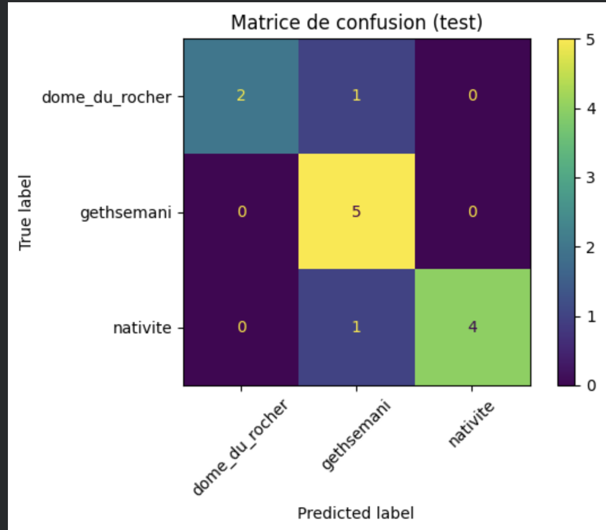
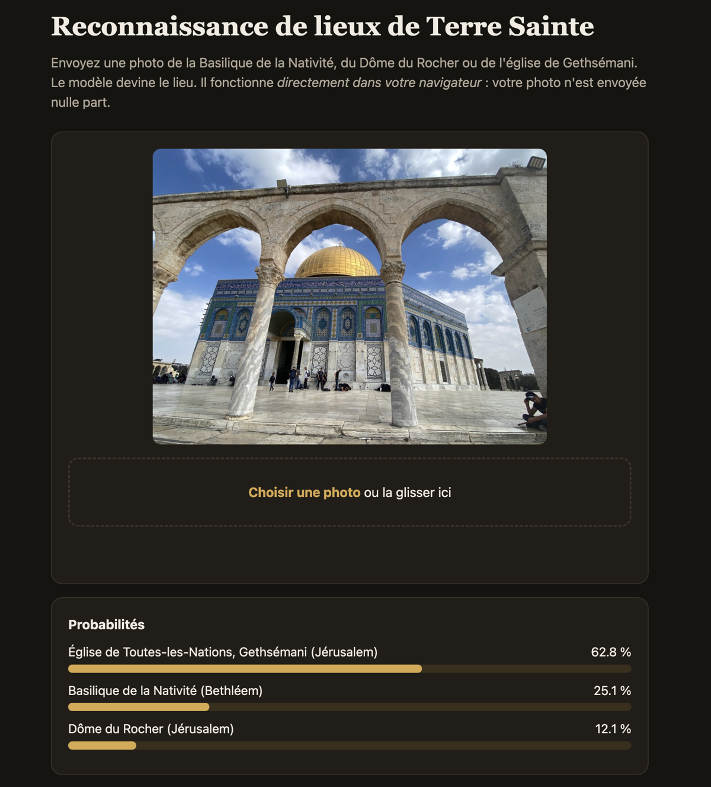

# Reconnaissance de lieux de Terre Sainte

Classification d'images par transfer learning : à partir d'une photo, le modèle reconnaît l'un de ces trois lieux :

- la Basilique de la Nativité (Bethléem)
- le Dôme du Rocher (Jérusalem)
- l'église de Toutes-les-Nations, à Gethsémani (Jérusalem)

**Démo :** https://holy-land-demo.netlify.app (le modèle tourne directement dans le navigateur)

Je viens de Bethléem. J'ai voulu travailler sur des lieux que je connais, avec très peu de données, ce qui est souvent le cas dans un vrai projet.

## Données

| Lieu | Train | Test |
|---|---|---|
| Dôme du Rocher | 7 | 3 |
| Gethsémani | 16 | 5 |
| Nativité | 15 | 5 |
| **Total** | **38** | **13** |

- Photos d'intérieur et d'extérieur, de jour et de nuit.
- Les photos presque identiques (même endroit, même moment) ont été retirées ou gardées du même côté, pour éviter qu'une photo du test ait sa « jumelle » dans le train.
- Pour Gethsémani, les photos de test viennent d'une autre visite que celles du train.
- Les photos ne sont pas publiées dans ce dépôt (source : Palestine Mediagraph).

## Méthode

Avec moins de 20 photos par lieu, entraîner un réseau de neurones entier n'est pas réaliste. J'utilise donc ResNet18 pré-entraîné sur ImageNet comme extracteur de features :

```
photo -> ResNet18 (sans la dernière couche) -> vecteur de 512 features -> classifieur
```

Deux classifieurs sont comparés : une régression logistique (avec StandardScaler) et un k-NN (k=3, distance cosinus). Pour mesurer l'apport du pré-entraînement, je refais la même chose avec un ResNet18 aux poids aléatoires.

## Résultats

Précision sur le test (13 photos) :

| Méthode | Précision |
|---|---|
| Hasard | 33,3 % |
| ResNet18 aléatoire + régression logistique | 61,5 % |
| ResNet18 pré-entraîné + régression logistique | **84,6 %** |
| ResNet18 pré-entraîné + k-NN | **84,6 %** |



Les deux erreurs sont prédites « Gethsémani » :

- **Une photo du Dôme du Rocher prise sous les arcades.** Les arcades et les colonnes de marbre au premier plan ressemblent à la façade de Gethsémani, et le dôme est au fond. Aucune photo du train ne montre le Dôme avec ces arcades.
- **L'iconostase de la Nativité.** Intérieur sombre, lampes dorées, colonnes : c'est la même ambiance que l'intérieur de Gethsémani.

Le modèle reconnaît bien le style (arcades, colonnes, lumière dorée), mais il a du mal quand ce style est partagé par plusieurs lieux.



Avec seulement 2 lieux (Nativité et Dôme), j'obtenais 87,5 à 100 % de précision, mais l'écart avec le modèle sans pré-entraînement (75 %) était trop petit pour conclure. Le 3ᵉ lieu, Gethsémani, a été choisi parce qu'il ressemble aux deux autres.

## Limites

- Le test ne contient que 13 photos : une erreur fait varier la précision d'environ 8 points. Les chiffres sont indicatifs.
- Les classes sont déséquilibrées (10 photos pour le Dôme, environ 20 pour les autres).
- Le modèle ne connaît que 3 lieux. Pour une photo d'un autre lieu, il donne quand même une réponse ; la démo affiche « Je ne suis pas sûr » seulement si la probabilité maximale est sous 60 %.
- Le choix du classifieur et du seuil n'a pas été fait sur un jeu de validation séparé.

## Pistes

- Ajouter des photos du Dôme du Rocher avec les arcades, et d'autres lieux.
- Fine-tuning de la dernière partie de ResNet18 (`layer4`).
- Validation croisée pour avoir des chiffres plus fiables.

## Démo web

Pour la démo, le StandardScaler et la régression logistique sont fusionnés en une seule couche linéaire ajoutée à la fin de ResNet18, puis le modèle complet est exporté en ONNX. La page `demo/index.html` l'exécute dans le navigateur avec ONNX Runtime Web : pas de serveur, et la photo ne quitte pas l'ordinateur de l'utilisateur. Le site est hébergé sur Netlify.

## Lancer le projet

1. Mettre les photos sur Google Drive dans `lieux/train/<lieu>/` et `lieux/test/<lieu>/`.
2. Ouvrir `notebook/reconnaissance_lieux.ipynb` dans Google Colab et tout exécuter.
3. La dernière cellule crée `modele.onnx`. Le mettre dans le dossier `demo/` à côté de `index.html` pour lancer la démo.

## Outils

Python, PyTorch, torchvision, scikit-learn, ONNX, ONNX Runtime Web, Google Colab, Netlify.
